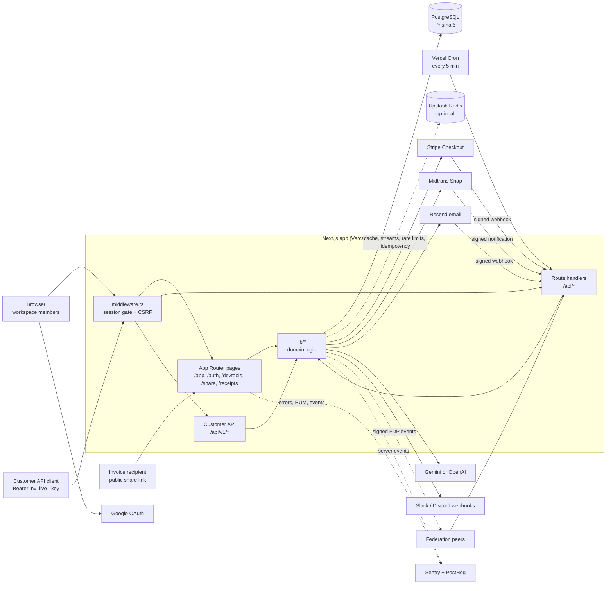
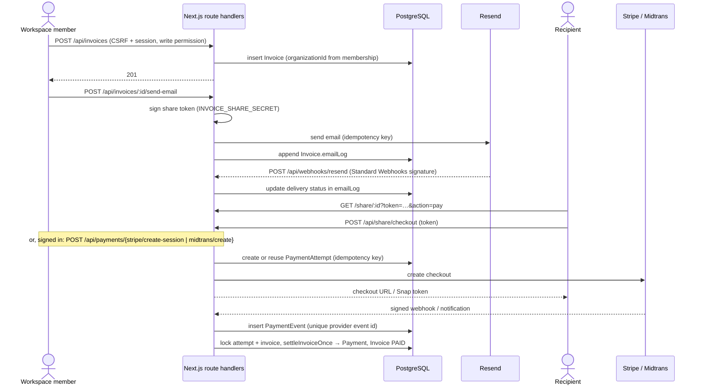
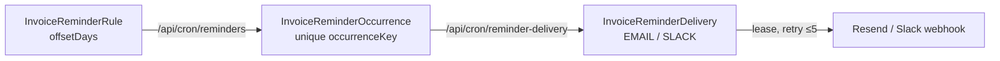
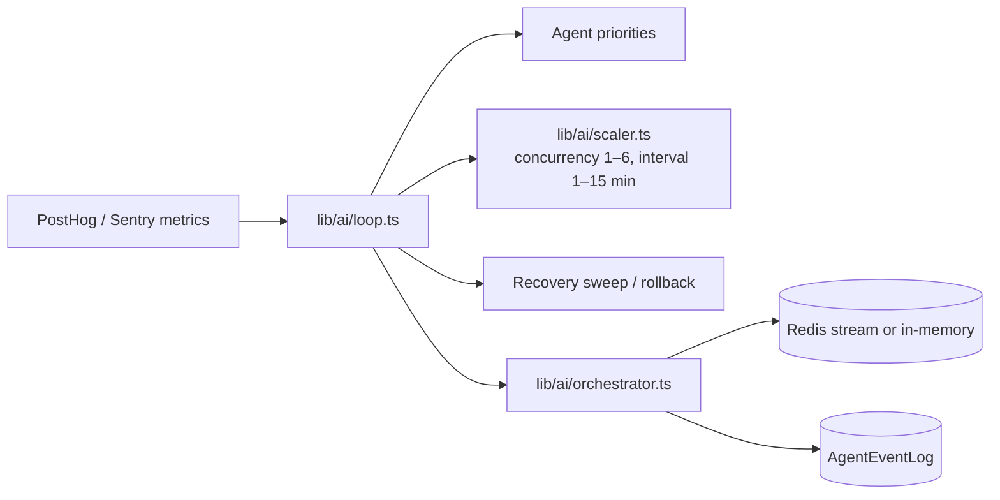
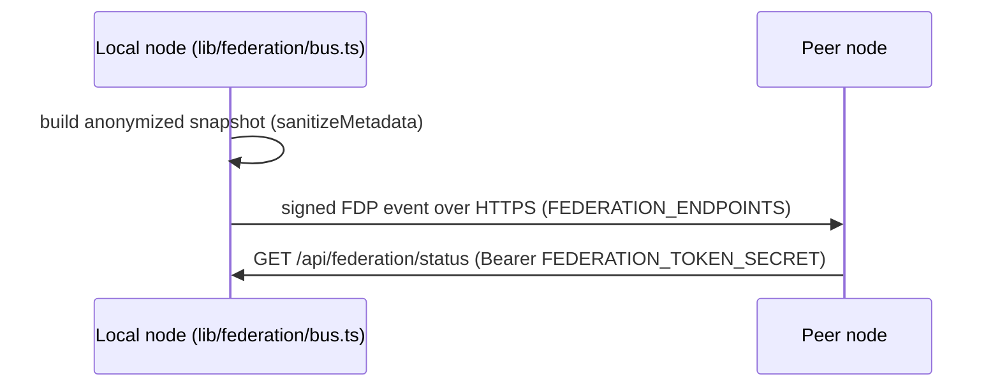

# InvoSmart System Architecture

InvoSmart is a multi-tenant invoice and receipt platform with online payments, a customer API, and an optional autonomous AI optimization subsystem. It is one Next.js 15 (App Router) application backed by PostgreSQL, deployed on Vercel.

Related docs: [SECURITY.md](../SECURITY.md) · [DEPLOYMENT.md](./DEPLOYMENT.md) · [DATABASE.md](./DATABASE.md) · [WORKSPACE_RBAC.md](./WORKSPACE_RBAC.md) · [API.md](./API.md) · [INTEGRATIONS.md](./INTEGRATIONS.md) · [AI docs](./ai/) · [ADRs](./adr/)

_Last reviewed against the code: 2026-10-16._

## 1. Container view



| Container | What runs there | Code |
|---|---|---|
| Middleware | Requires a NextAuth session for `/app/*`, enforces double-submit CSRF on mutating `/api/*` calls, and exempts signed provider webhooks and `/api/v1` bearer requests | `middleware.ts`, `lib/security/csrf.ts` |
| Pages | Authenticated app (`app/app/*`), auth pages (`app/auth/*`), platform-admin DevTools (`app/devtools/*`), public invoice share page (`app/share/[id]`), public receipt verification (`app/receipts/[id]/verify`) | `app/` |
| Route handlers | Browser-session JSON API (72 `route.ts` files) | `app/api/` |
| Customer API | Versioned API authenticated by workspace API keys | `app/api/v1/`, `lib/api-v1/` |
| PostgreSQL | System of record for every entity (32 Prisma models) | `prisma/schema.prisma` |
| Upstash Redis | Optional. Used for the AI event stream, scaler state, theme-suggestion cache, and v1 rate limiting and idempotency. Each use has an in-process fallback (see §6) | `lib/ai/orchestrator.ts`, `lib/ai/scaler.ts`, `lib/cache/`, `lib/api-v1/redis.ts` |

## 2. Domains

### Workspaces and tenancy
- An `Organization` (workspace) owns business data. Users join through `Membership`, which has one of four roles: `OWNER`, `ADMIN`, `MEMBER` or `VIEWER` (`prisma/schema.prisma:39-44`). New users get a personal workspace (`lib/workspace-provisioning.ts`).
- **Tenancy resolution** (`resolveWorkspaceContext`, `lib/workspaces.ts:91`): the workspace comes from the `organizationId` query parameter or the `x-organization-id` header. If neither is present, it falls back to the user's `activeOrganizationId`, then to the user's oldest membership. The membership is always checked server-side. Queries are scoped with `workspaceScope()` (`lib/workspaces.ts:199`), and a client-supplied organization id is never merged into a filter.
- **`WORKSPACE_AUTH_MODE`** (`lib/workspaces.ts:28-37`):
  - `compat` (default): falls back to legacy user-owned rows and provisions a personal workspace on demand.
  - `enforce`: fails closed when no membership resolves.
  - Switch to `enforce` only after `npm run db:backfill-workspaces` (`lib/workspace-backfill.ts`). The rollout order is in [WORKSPACE_RBAC.md](./WORKSPACE_RBAC.md).
- **Permissions** come from one matrix (`lib/workspaces.ts:53-58`, checked by `hasWorkspacePermission`). Platform administration (DevTools, global flags, uptime) is separate. It is keyed on `User.id` values in `ADMIN_USER_IDS`, not on email addresses (`lib/devtools/access.ts:23`). See [ADR 014](./adr/014-workspace-tenancy-rbac.md).

### Invoices, clients, templates, export
- The invoice routes (`app/api/invoices/*`) and client routes (`app/api/clients/*`) are workspace-scoped and validated with Zod (`lib/schemas.ts`).
- PDFs are generated on request by `app/api/invoices/[id]/pdf` using pdf-lib (`lib/pdf-generator.ts`), not when the invoice is created.
- Recurring templates live in `app/api/invoices/templates/*`. CSV/XLSX export is in `app/api/invoices/export` and `lib/export-utils.ts`.
- Invoice statuses: `DRAFT`, `SENT`, `PAID`, `UNPAID`, `OVERDUE` (`schema.prisma:250-255`).

### Invoice delivery and reminders
- **Sending** (`app/api/invoices/[id]/send-email/route.ts`):
  - Builds an HMAC-signed share URL. The key is `INVOICE_SHARE_SECRET`, falling back to `NEXTAUTH_SECRET` (`lib/invoice-delivery.ts:320`).
  - Sends through Resend with an idempotency key.
  - Records attempts in `Invoice.emailLog`, with up to 3 retries (`lib/invoice-delivery.ts:21`).
- **Delivery status**: Resend webhooks (`app/api/webhooks/resend`, Standard Webhooks signature verified by `lib/email/resend.ts`) update `emailLog`.
- **Reminders** run as a pipeline of three tables:
  1. `InvoiceReminderRule`: a per-workspace offset in days from the due date.
  2. `InvoiceReminderOccurrence`: created by cron `/api/cron/reminders` for invoices that are `SENT`, `UNPAID` or `OVERDUE`. Occurrences are deduplicated by a unique `occurrenceKey` (`lib/team/reminders.ts`).
  3. `InvoiceReminderDelivery`: one row per channel (EMAIL or SLACK), sent by cron `/api/cron/reminder-delivery`. Deliveries use leases (10 minutes), idempotency keys, and up to 5 attempts with backoff (`lib/team/reminder-delivery.ts:29-31`).
- Per-workspace Slack webhook URLs are encrypted with `WORKSPACE_NOTIFICATION_ENCRYPTION_KEY` (`lib/team/secrets.ts`).

### Payments
- **Providers**: Stripe Checkout and Midtrans Snap (`lib/payments/stripe.ts`, `lib/payments/midtrans.ts`).
- **Starting a checkout**: a workspace member with `write` permission starts it from the invoice detail page (`components/payments/PaymentGatewayModal.tsx`), or the invoice recipient starts it from the public share page through `POST /api/share/checkout`, authorised by the share token (see §3). Both paths use the shared helpers in `lib/payments/checkout.ts`. A checkout can be started for invoices in `SENT`/`UNPAID`/`OVERDUE` only (`DRAFT` and `PAID` are refused with `409`; `PAYABLE_INVOICE_STATUSES` in `lib/payments/lifecycle.ts`). This creates a `PaymentAttempt` with an idempotency key. The attempt is unique per `(provider, idempotencyKey)` and per `(provider, providerOrderId)`, and it reuses an active attempt for 30 minutes (`lib/payments/lifecycle.ts:39`). A Stripe Checkout Session gets `expires_at` at the attempt expiry, raised to Stripe's 30-minute minimum plus a 2-minute margin, and the attempt expiry is moved to match (`stripeSessionExpiresAt` in `lib/payments/checkout.ts`), so an attempt never expires while its session can still be paid.
- **Attempt states**: `PENDING`, `AUTHORIZED`, `SETTLED`, `EXPIRED`, `CANCELLED`, `FAILED`, `REFUNDED`. Allowed transitions are decided in `decidePaymentTransition` (`lib/payments/lifecycle.ts:204`).
- **Reconciliation**: signed provider events (Stripe `constructEvent`, Midtrans `verifyMidtransSignature`) are stored once in `PaymentEvent`, which is unique on `(provider, providerEventId)`. Settlement then runs `settleInvoiceOnce` (`lib/payments/settlement.ts:85`). It locks the attempt and the invoice, records at most one `Payment` per attempt, and flags duplicate settlements for refund or manual review rather than recording them twice. See [ADR 015](./adr/015-payment-providers-webhook-reconciliation.md).
- **Amounts**: currency and amount are re-verified against the invoice on every event (`verifyAmountAndCurrency`). Stripe minor units are handled in `lib/payments/money.ts`.

### Customer API v1
- **Authentication**: bearer API keys `inv_live_<prefix>_<secret>` (`lib/api-keys.ts`). Only a SHA-256 hash of the secret is stored. Each key belongs to one workspace and has scopes `invoices:read|write` and `clients:read|write`. New keys get read-only scopes by default. Keys are managed through `app/api/workspaces/[id]/api-keys/*`, which requires `manage_workspace`.
- **Write idempotency**: writes accept `Idempotency-Key` (`lib/api-v1/idempotency.ts`).
- **Rate limits**: per key, 120 requests/min by default (`lib/api-v1/rate-limit.ts:15`).
- **Contract**: the OpenAPI document is generated from `lib/openapi.ts` and served at `/api/openapi.json`. Details are in [API.md](./API.md).

### Receipts
- Receipts are created from invoices (`lib/receipts/service.ts`). Each one has a verification token, stamp assets and its own audit trail (`ReceiptAuditLog`).
- Verification is public at `/receipts/[id]/verify`.
- Receipt image scanning uses the LLM client (`app/api/receipts/ai-scan`).

### Platform features
- **i18n**: `en` and `id` locales (`lib/i18n/locales/`). The user's choice is stored in `User.locale` through `/api/user/locale`.
- **Feature flags**: stored in the database and evaluated by `getFlag()`, with tenant and user targeting (`lib/feature-flags.ts`). Platform admins manage them in `/app/admin/feature-flags`.
- **Uptime**: cron `/api/cron/uptime` checks `UPTIME_MONITORED_ENDPOINTS` (default `/api/health?db=1` on the deployed host: `NEXT_PUBLIC_APP_URL`, `NEXTAUTH_URL` or `https://$VERCEL_URL`) and stores `UptimeCheck` rows. `/api/health` alone is a shallow liveness check; `?db=1` adds a rate-limited `SELECT 1` with a 2 s timeout and answers `503` when it fails. Failures are alerted through `dispatchWebhookAlert` to Slack/Discord (`lib/monitoring/uptime.ts`).
- **Audit logging**: `logAuditEvent` writes to `AuditLog` for invoice, auth, security and AI auto-action events (`lib/audit/auditLogger.ts`).

### AI features
- **LLM client**: `lib/ai.ts` uses Gemini (`gemini-2.5-flash`) when `GEMINI_API_KEY` is set, otherwise OpenAI (`gpt-4o-mini`). The primary is chosen by configuration; when both keys are set, a timeout, network error or HTTP 408/429/5xx is retried once on the other provider, and every call is bounded by `AI_REQUEST_TIMEOUT_MS` (default 20 s). See [ADR 012](./adr/012-gemini-first-ai-provider.md).
- **Uses**: invoice composition from natural language (`app/api/invoices/ai`), receipt scanning, invoice insight, theme suggestions, and recommendation explanations.
- **Autonomous agent subsystem**: six agents (optimizer, learning, governance, insight, recovery, federation) communicate through the MAP protocol and an orchestrator. Each is gated by `ENABLE_AI_*` flags. Content variants are scored with LinUCB ([ADR 013](./adr/013-linucb-content-selection.md)). Details: [docs/ai/](./ai/) and [AGENTS.md](../AGENTS.md).
  - The autonomy loop (`lib/ai/loop.ts`) runs in-process on `setTimeout`. A platform admin starts it through `/api/devtools/autonomy`, and no cron schedules it. On serverless instances it lasts only as long as the instance does.

## 3. Key flows

### Invoice → send → pay → reconcile



The email also contains a payment link: the share URL with `?action=pay` (`send-email/route.ts:131`). The public share page (`app/share/[id]/page.tsx`) shows a pay button (`SharePayButton.tsx`) for payable invoices and, with `action=pay`, starts the default provider once on load: `IDR` → Midtrans, any other currency → Stripe, or whichever single provider is configured and can charge the currency (`pickShareCheckoutProvider` in `lib/payments/checkout.ts`). The button posts `{ invoiceId, token, provider }` to `POST /api/share/checkout`, which verifies the share token (bad, expired or foreign token → `404`), never reads a session or cookie, ignores any client `Idempotency-Key` and uses a server-side key per invoice, provider and 30-second window (a later window reuses the active share attempt), and answers only the Stripe URL or the Snap token. Stripe returns the recipient to the share URL with `payment=success|cancelled`; that parameter is display-only, and the status shown is `invoice.status`, which only the signed webhooks move to `PAID`. Signed-in members still start checkout from the invoice detail page.

### Reminder pipeline



### AI optimization loop



### Federation



## 4. Technology decisions

| Category | Technology | Purpose | ADR |
|---|---|---|---|
| Framework | Next.js 15 App Router, React 18 | Pages, route handlers, middleware | [001](./adr/001-nextjs-app-router.md) |
| Language | TypeScript 5.9 | Type safety | |
| Styling | Tailwind CSS v4, Framer Motion, Recharts, React Flow | UI, charts, agent graph | [008](./adr/008-glassmorphism-design-system.md) |
| Database | PostgreSQL via Prisma 6 (all environments). PGlite for e2e and integration tests | System of record | [011](./adr/011-postgresql-only.md) (supersedes 002) |
| Cache and bus | Upstash Redis, optional, with in-process fallbacks | AI stream, caches, v1 rate limits and idempotency | [004](./adr/004-upstash-redis-event-bus.md) |
| Auth | NextAuth 4 (Credentials + Google), JWT sessions | Browser sessions | |
| Tenancy | Organization + Membership, 4 roles | Workspace isolation and RBAC | [014](./adr/014-workspace-tenancy-rbac.md) |
| Payments | Stripe Checkout, Midtrans Snap | Online invoice payment | [015](./adr/015-payment-providers-webhook-reconciliation.md) |
| Email | Resend | Invoice and reminder delivery | |
| Validation | Zod | Request validation | |
| LLM | Gemini (preferred when configured), OpenAI | Composer, scanner, insights | [012](./adr/012-gemini-first-ai-provider.md) (supersedes 005) |
| Experimentation | LinUCB scoring; Bayesian Beta-Binomial readouts | Content optimization | [013](./adr/013-linucb-content-selection.md) (supersedes 006) |
| Observability | Sentry, PostHog (client + `posthog-node`) | Errors, RUM, events | [007](./adr/007-sentry-posthog-observability.md) |
| PDF | pdf-lib | Invoice and receipt PDFs | |

## 5. Directory map

```
app/
├── api/                 # route handlers: admin, ai, ai-optimizer, auth, clients, cron, dev, devtools,
│                        #   federation, health, insight, invoices, openapi.json, opt, payments,
│                        #   receipts, user, v1, webhooks, workspace-invitations, workspaces
├── app/                 # authenticated app: dashboard, invoices, clients, receipts, insight, ai-invoice,
│                        #   workspaces, workspace-invitations, settings, profile, admin, help, about
├── app-settings/        # receipt settings
├── auth/                # login, register
├── devtools/            # platform-admin AI dashboards (agents, audit, autonomy, federation, learning, tuning, perf)
├── receipts/[id]/       # public receipt verification
└── share/[id]/          # public signed invoice view
components/              # UI (auth, invoices, layout, payments, telemetry, ui, …)
context/, hooks/         # React contexts and hooks
lib/
├── ai/                  # agents, orchestrator, protocol, loop, scaler, optimizers, bayesian-ab
├── api-v1/              # customer API auth, rate limit, idempotency, schemas
├── audit/               # AuditLog writer
├── cache/               # theme-suggestion cache (Redis + memory)
├── devtools/            # platform-admin access
├── email/               # Resend client and webhook verification
├── federation/          # FDP bus and protocol
├── i18n/                # en / id
├── invoices/            # invoice helpers
├── monitoring/          # uptime checks
├── payments/            # lifecycle, settlement, Stripe, Midtrans, money
├── receipts/            # receipt service, guards, PDF
├── security/            # CSRF, CSP
├── stats/               # frequentist A/B helpers
├── team/                # reminders, reminder delivery, Slack, invitations, secrets
├── workspaces.ts        # tenancy resolution and permission matrix
└── api-keys.ts, openapi.ts, feature-flags.ts, rate-limit.ts, cron-auth.ts, …
middleware.ts            # session gate + CSRF
prisma/                  # schema.prisma, migrations/, seed.ts
server/auth.ts           # NextAuth options
test/                    # e2e (Playwright), integration (Vitest + PGlite)
```

## 6. Cross-cutting concerns

- **Security** (summary; [SECURITY.md](../SECURITY.md) is the canonical source):
  - Sessions are NextAuth JWTs. Passwords are hashed with bcrypt.
  - Every mutating browser `/api/*` call is CSRF-checked. Security headers and CSP are set in `next.config.ts` / `lib/security/csp.ts`.
  - Selected routes call `enforceHttps` (`lib/security.ts`) and a per-instance, in-memory limit of 10 requests per minute per IP per bucket (`lib/rate-limit.ts`). This is not a global rate limit. `/api/v1` has its own per-key limit.
  - Provider webhooks, cron routes (`CRON_SECRET` bearer, `lib/cron-auth.ts`) and federation peers authenticate with signatures or secrets, not sessions.
- **Caching and Redis fallbacks**:
  - Theme suggestions are cached for 1 hour, in Redis or in memory (`lib/cache/theme-suggestions.ts`).
  - Static assets are served with `Cache-Control: public, max-age=31536000, immutable` (`next.config.ts`).
  - If Redis is configured but unreachable, `/api/v1` rate limiting falls back to a process-local window, while idempotent writes are refused rather than risk a duplicate (`lib/api-v1/idempotency.ts:134`).
- **Observability**: Sentry client and server configs, PostHog in the browser plus server events through `lib/server-telemetry.ts`, and web-vitals RUM (`lib/rum.ts`).

## 7. Deployment

The app runs on Vercel, and three Vercel crons each run every 5 minutes (`vercel.json`). CI and release run in `.github/workflows/release.yml`. The `deploy` job applies database migrations (`prisma migrate deploy`) before `vercel deploy --prod`. [DEPLOYMENT.md](./DEPLOYMENT.md) covers the release order, migrations, rollback and environment configuration.
